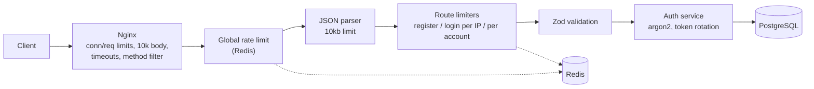

# auth-shield-api

An authentication API that protects itself. Besides login and token handling, it filters abusive traffic in layers, so brute force, floods and token theft are stopped before they overload the server.

**Stack:** Node.js · Express 5 · TypeScript · PostgreSQL · Prisma · Redis · JWT · argon2 · Zod · Nginx · Docker

## Features

| Status | Feature                                                                    |
| ------ | -------------------------------------------------------------------------- |
| ✅     | Register / login with argon2id password hashing                            |
| ✅     | Short-lived JWT access token (15 min) + opaque refresh token (7 days)      |
| ✅     | Refresh token rotation with **reuse detection** (token family revocation)  |
| ✅     | Logout (revokes the token family) and protected `GET /me`                  |
| ✅     | Redis-backed rate limiting: global, register, login per IP and per account |
| ✅     | Nginx edge limits: requests, connections, body size, timeouts, methods     |
| ✅     | Validation with Zod, centralized typed error handling                      |
| 🔜     | Temporary account lockout, progressive slow-down, IP blacklist             |
| 🔜     | Helmet, CORS allowlist, hpp, security event audit log                      |
| 🔜     | Automated tests, k6 load/attack results, CI/CD                             |

## Architecture



Each layer rejects a class of abuse before it reaches the next, more expensive one.

## Endpoints

| Method | Path             | Auth          | Description                    |
| ------ | ---------------- | ------------- | ------------------------------ |
| POST   | `/auth/register` | –             | Create account                 |
| POST   | `/auth/login`    | –             | Returns access + refresh token |
| POST   | `/auth/refresh`  | refresh token | Rotates the refresh token      |
| POST   | `/auth/logout`   | refresh token | Revokes the token family       |
| GET    | `/me`            | Bearer        | Current user                   |
| GET    | `/health`        | –             | Liveness check                 |

## Quick start

Requires Docker.

```bash
cp .env.example .env
docker compose up --build
docker compose exec api npx prisma migrate deploy
curl http://localhost:8080/health
```

The API is served through Nginx on port **8080**. The Express container is not exposed directly.

```bash
curl -X POST http://localhost:8080/auth/register \
  -H 'content-type: application/json' \
  -d '{"email":"a@b.com","password":"Strong12345"}'

curl -X POST http://localhost:8080/auth/login \
  -H 'content-type: application/json' \
  -d '{"email":"a@b.com","password":"Strong12345"}'
```

## Technical decisions

| Decision                                                  | Why                                                                      |
| --------------------------------------------------------- | ------------------------------------------------------------------------ |
| argon2id                                                  | Memory-hard password hashing; resists GPU cracking                       |
| Refresh token is random, stored as SHA-256 hash           | A database leak does not expose usable tokens; revocable, unlike a JWT   |
| Rotation + token families                                 | Each refresh token works once; a replayed token revokes the whole family |
| Atomic "claim" of the refresh token                       | Two simultaneous uses of one token cannot both succeed                   |
| Redis for rate limits                                     | Shared counters survive restarts and scale across instances              |
| Limits per IP **and** per account                         | IP-only limits fail against distributed attacks                          |
| Only failed logins count toward login limits              | Legitimate users are not punished                                        |
| Dummy hash for unknown users                              | Equal response time, so emails cannot be enumerated by timing            |
| JWT algorithm pinned to HS256                             | Blocks algorithm-substitution attacks                                    |
| `trust proxy = 1` and Nginx overwriting `X-Forwarded-For` | Clients cannot spoof their IP to bypass limits                           |

## Threat model

| Threat                            | Mitigation                                           |
| --------------------------------- | ---------------------------------------------------- |
| Brute force on one account        | Per-IP and per-account login limits                  |
| Distributed credential guessing   | Per-account limit across all IPs                     |
| User enumeration                  | Generic login errors, constant-time check            |
| Request flood / DoS               | Nginx rate and connection limits, global Redis limit |
| Slowloris                         | Nginx header/body/send timeouts                      |
| Oversized or malformed payloads   | 10 KB cap at Nginx and Express, Zod validation       |
| Stolen refresh token              | Rotation, reuse detection, family revocation         |
| Database leak                     | argon2id hashes, hashed refresh tokens               |
| IP spoofing via `X-Forwarded-For` | Single trusted hop, header overwritten at the edge   |

## Known trade-offs

- Per-account limits let an attacker temporarily block a victim's login attempts.
- `POST /auth/register` returns `409` for an existing email (reveals that it exists). Email verification would remove this.
- Access tokens stay valid until they expire (max 15 min) after logout.

## Project structure

```
src/
  config/        env validation (Zod)
  middlewares/   authenticate, rate limiters, error handler
  modules/
    auth/        routes, schemas, service
    users/       /me
  shared/        prisma, redis, password, tokens, errors
prisma/          schema and migrations
nginx/           reverse proxy config
```

## License

MIT
