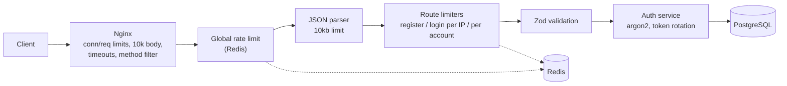

[English](README.md) | **Português (BR)**

# auth-shield-api

Uma API de autenticação que se protege sozinha. Além de login e gerenciamento de tokens, ela filtra tráfego abusivo em camadas, de modo que força bruta, floods e roubo de tokens são barrados antes de sobrecarregar o servidor.

**Stack:** Node.js · Express 5 · TypeScript · PostgreSQL · Prisma · Redis · JWT · argon2 · Zod · Nginx · Docker

## Funcionalidades

| Status | Funcionalidade                                                                        |
| ------ | ------------------------------------------------------------------------------------- |
| ✅     | Registro e login com hash de senha argon2id                                           |
| ✅     | Access token JWT de curta duração (15 min) + refresh token opaco (7 dias)             |
| ✅     | Rotação de refresh token com **detecção de reuso** (revogação da família de tokens)   |
| ✅     | Logout (revoga a família de tokens) e rota protegida `GET /me`                        |
| ✅     | Rate limiting com Redis: global, registro, login por IP e por conta                   |
| ✅     | Limites na borda com Nginx: requisições, conexões, tamanho de body, timeouts, métodos |
| ✅     | Validação com Zod e tratamento de erros centralizado e tipado                         |
| 🔜     | Bloqueio temporário de conta, slow-down progressivo, blacklist de IPs                 |
| 🔜     | Helmet, CORS com allowlist, hpp, log de auditoria de eventos de segurança             |
| 🔜     | Testes automatizados, resultados de carga/ataque com k6, CI/CD                        |

## Arquitetura



Cada camada barra uma classe de abuso antes que ela chegue à próxima, mais custosa.

## Endpoints

| Método | Rota             | Autenticação  | Descrição                      |
| ------ | ---------------- | ------------- | ------------------------------ |
| POST   | `/auth/register` | –             | Cria conta                     |
| POST   | `/auth/login`    | –             | Retorna access + refresh token |
| POST   | `/auth/refresh`  | refresh token | Rotaciona o refresh token      |
| POST   | `/auth/logout`   | refresh token | Revoga a família de tokens     |
| GET    | `/me`            | Bearer        | Usuário atual                  |
| GET    | `/health`        | –             | Verificação de disponibilidade |

## Início rápido

Requer Docker.

```bash
cp .env.example .env
docker compose up --build
docker compose exec api npx prisma migrate deploy
curl http://localhost:8080/health
```

A API é servida pelo Nginx na porta **8080**. O container do Express não é exposto diretamente.

```bash
curl -X POST http://localhost:8080/auth/register \
  -H 'content-type: application/json' \
  -d '{"email":"a@b.com","password":"Strong12345"}'

curl -X POST http://localhost:8080/auth/login \
  -H 'content-type: application/json' \
  -d '{"email":"a@b.com","password":"Strong12345"}'
```

## Decisões técnicas

| Decisão                                                    | Por quê                                                                                 |
| ---------------------------------------------------------- | --------------------------------------------------------------------------------------- |
| argon2id                                                   | Hash de senha que consome muita memória; resiste a cracking por GPU                     |
| Refresh token aleatório, guardado como hash SHA-256        | Um vazamento do banco não expõe tokens utilizáveis; é revogável, ao contrário de um JWT |
| Rotação + famílias de tokens                               | Cada refresh token vale uma única vez; um token reutilizado revoga a família inteira    |
| "Claim" atômico do refresh token                           | Dois usos simultâneos do mesmo token não podem ter sucesso                              |
| Redis para rate limits                                     | Contadores compartilhados sobrevivem a reinícios e escalam entre instâncias             |
| Limites por IP **e** por conta                             | Limites só por IP falham contra ataques distribuídos                                    |
| Só logins falhos contam nos limites de login               | Usuários legítimos não são punidos                                                      |
| Hash fictício para usuários inexistentes                   | Tempo de resposta igual, então e-mails não podem ser enumerados por timing              |
| Algoritmo do JWT fixado em HS256                           | Bloqueia ataques de troca de algoritmo                                                  |
| `trust proxy = 1` e Nginx sobrescrevendo `X-Forwarded-For` | Clientes não conseguem falsificar o IP para burlar os limites                           |

## Modelo de ameaças

| Ameaça                                   | Mitigação                                                   |
| ---------------------------------------- | ----------------------------------------------------------- |
| Força bruta em uma conta                 | Limites de login por IP e por conta                         |
| Tentativas distribuídas de senha         | Limite por conta, somando todos os IPs                      |
| Enumeração de usuários                   | Erros genéricos no login, verificação em tempo constante    |
| Flood de requisições / DoS               | Limites de taxa e conexões no Nginx, limite global no Redis |
| Slowloris                                | Timeouts de header/body/envio no Nginx                      |
| Payloads grandes ou malformados          | Limite de 10 KB no Nginx e no Express, validação com Zod    |
| Refresh token roubado                    | Rotação, detecção de reuso, revogação da família            |
| Vazamento do banco                       | Hashes argon2id, refresh tokens armazenados como hash       |
| Falsificação de IP via `X-Forwarded-For` | Um único proxy confiável, header sobrescrito na borda       |

## Trade-offs conhecidos

- Limites por conta permitem que um atacante bloqueie temporariamente as tentativas de login de uma vítima.
- `POST /auth/register` retorna `409` para e-mail já cadastrado (revela que ele existe). A verificação de e-mail eliminaria isso.
- Access tokens continuam válidos até expirar (máx. 15 min) após o logout.

## Estrutura do projeto

```
src/
  config/        validação de env (Zod)
  middlewares/   authenticate, rate limiters, error handler
  modules/
    auth/        rotas, schemas, service
    users/       /me
  shared/        prisma, redis, password, tokens, errors
prisma/          schema e migrations
nginx/           configuração do reverse proxy
```

## Roadmap

- [ ] Bloqueio temporário de conta e slow-down progressivo
- [ ] Blacklist dinâmica de IPs e log de auditoria `security_events`
- [ ] Helmet, CORS com allowlist, hpp
- [ ] Testes unitários, de integração e de segurança
- [ ] Cenários de carga e ataque com k6, com resultados neste README
- [ ] CI (lint, typecheck, testes, build da imagem, audit)
- [ ] Fora do escopo por enquanto: MFA, OAuth, verificação de e-mail, reset de senha

## Licença

MIT
